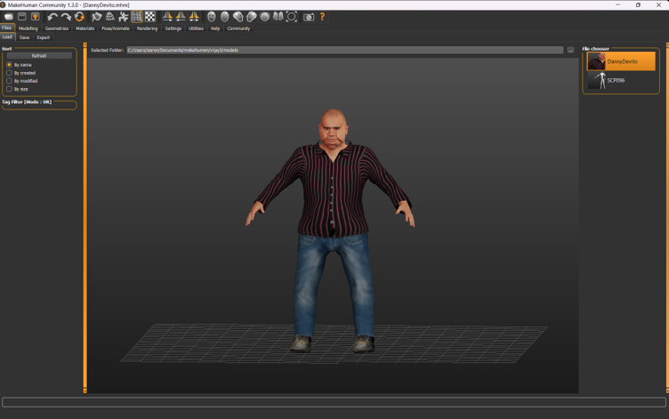
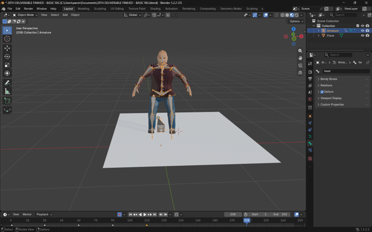
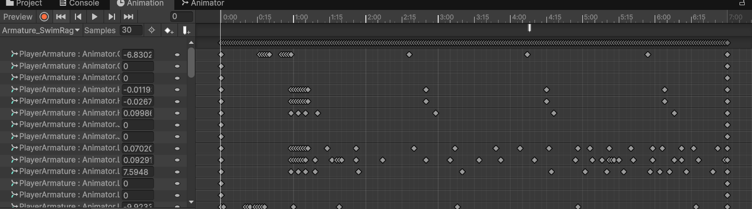

# Animation Continuous Assessment Report

## Deliverable 1: Avatar creation in makehuman and import to blender

For the first deliverable I made a basic humanoid character in makehuman using the tools the software provides such as body type control, hair and clothing. After this I imported the model into blender. Some issues were encountered, mainly that the textures were not displaying correctly which needed to be manually fixed by changing or removing alpha channels on each part. Then each part of the model was combined into one. After this I made a basic humanoid animation skeleton for rigging purposes.

Fig 1: My Danny Devito model in makehuman.

Fig 2: Imported into blender and created bones for rigging.

## Deliverable 2: Importing avatar into Unity and applying the model to the starter assets third person controller and its animations.

The next step was to add him into Unity from Blender. I exported the FBX and imported it into Unity and overwrote the Starter Assets third person default model. I then ensured that the animation skeletons were matching well enough so that the old animations would mask onto the new model.

Once that was working I went into Blender and made a basic head shake and swim animation to later import into Unity.

## Deliverable 3: Implementing new animations using ASM Blend trees, Meta channels and ragdolls.

The first thing I tackled was implementing ragdolling into my model. I used the ragdoll tool to automatically apply rigidbodies and colliders to individual body parts and bones. I had an issue initially where it made the head collider massive but I manually downscaled it. From there I implemented the 2 new animations by re-importing the FBX file from Blender and dragging the animations out from it. I tied the shake animation to the blend tree and make it so it does it when the player sprints, and I tied the swim animation to the r key.

Ragdolling is controller by two scripts, one controlling the ragdoll logic, and one that is called via a meta channel near the end of the swim animation. This makes it so the player presses r, swims for a second or two, then ragdolls.

Fig 3: Meta channel for ragdolling in swim animation.

Fig 4: Video demonstration of it all working together.

[Video demonstration](ScreenshotsandVid/demovideo.mkv)
